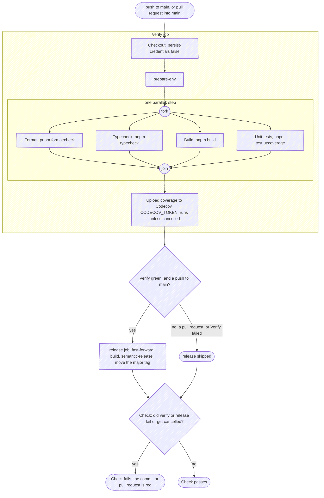
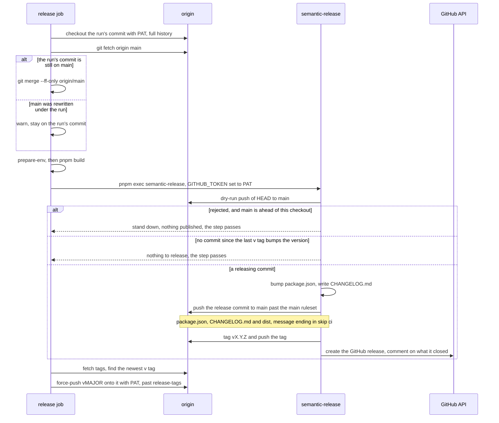
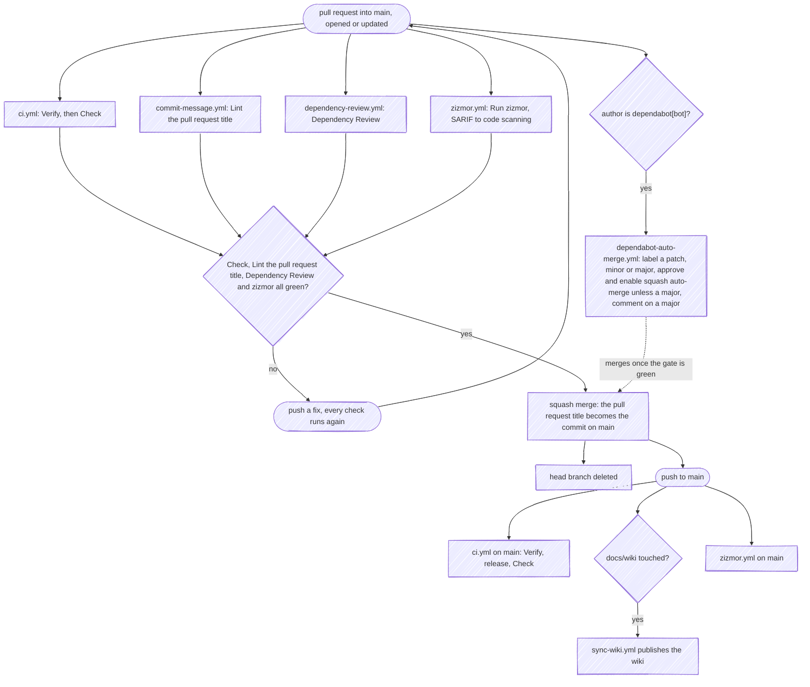
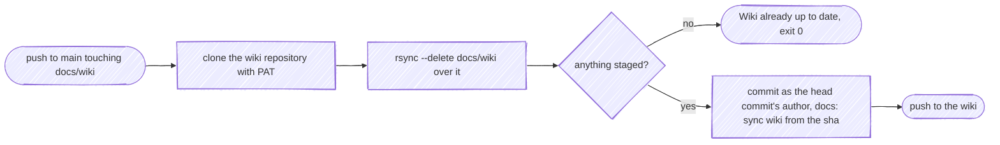

How this repository checks, releases and publishes itself: every workflow under
[`.github/workflows/`](https://github.com/fbuireu/github-star-tracker/tree/main/.github/workflows), what starts it, what
it needs and what you see when it fails. Nothing on this page runs in the repository where you *use* the action; for
that, start at [Getting Started](Getting-Started).

The scripts and git hooks are listed once in
[`AGENTS.md`](https://github.com/fbuireu/github-star-tracker/blob/main/AGENTS.md#commands), why the hooks stop where they
do is [`ARCHITECTURE.md`](https://github.com/fbuireu/github-star-tracker/blob/main/ARCHITECTURE.md#5-build--release),
and why the bundle is committed at all is
[ADR 0003](https://github.com/fbuireu/github-star-tracker/blob/main/docs/adr/0003-commit-the-bundled-dist-directory.md).

---

## The workflows

| Workflow | Runs on | Job (check name) | Does |
|---|---|---|---|
| `ci.yml` | push to `main`, pull requests into `main` | `verify` (`Verify`), `release` (`Semantic Release`), `check` (`Check`) | Runs the four checks of `pnpm verify` as parallel steps and uploads coverage, cuts the release on a push to `main`, and aggregates both into `Check` |
| `commit-message.yml` | pull requests into `main`: opened, edited, reopened, synchronize | `commitlint` (`Lint the pull request title`) | Runs commitlint on the pull request title, which is the message the squash merge lands and semantic-release reads |
| `dependency-review.yml` | every pull request | `dependency-review` (`Dependency Review`) | Fails a pull request that adds a dependency with a known vulnerability |
| `zizmor.yml` | push to `main`, pull requests into any branch | `zizmor` (`Run zizmor`) | Static analysis of the workflow files themselves, uploaded to code scanning as SARIF |
| `sync-wiki.yml` | push to `main` touching `docs/wiki/**` or the workflow itself | `sync` | Publishes `docs/wiki/` to this wiki |
| `dependabot-auto-merge.yml` | every pull request, opened or synchronized; the job runs only when the author is `dependabot[bot]` | `auto-merge` | Labels each patch, minor and major Dependabot update by its type, approves and auto-merges the safe ones, and comments on a major one |

One composite action backs them: `prepare-env`, which every job that installs dependencies calls
([below](#prepare-env)).

How runs of one workflow interact:

| Workflow | Concurrency group | A newer run cancels the one in progress |
|---|---|---|
| `ci.yml` | the workflow and the ref | On a pull request only. Pushes to `main` queue, so no release is cut short |
| `ci.yml`, `release` job | `release` | Never |
| `commit-message.yml` | the workflow and the ref | Yes |
| `sync-wiki.yml` | `sync-wiki` | Yes, the newest push carries every page anyway |
| `dependency-review.yml`, `zizmor.yml`, `dependabot-auto-merge.yml` | none | - |

The release commit ends in `[skip ci]`, so the push that lands it starts no workflow at all. That is load-bearing for
`ci.yml`: without it, the release commit would start the run that cuts the next release.

---

## The pipeline

A push to `main` and a pull request into `main` run the same `ci.yml`; only the push goes on to release.

What each piece guarantees:

- **The four checks run as one `parallel:` step.** `Format`, `Typecheck`, `Build` and `Unit tests` start together,
  each in its own log, and the `Verify` job fails if any of them fails. Locally, `pnpm verify` chains the same four
  scripts one after another.
- **`Unit tests` carries the coverage floor.** `pnpm test:ut:coverage` fails below 85% on lines, functions, branches
  or statements (`MIN_THRESHOLD` in
  [`vitest.config.mts`](https://github.com/fbuireu/github-star-tracker/blob/main/vitest.config.mts)), and the docs
  contract in [`docs/docs-consistency.test.ts`](https://github.com/fbuireu/github-star-tracker/blob/main/docs/docs-consistency.test.ts)
  runs inside it, so a doc that disagrees with the code fails the same step.
- **Codecov reports, it does not gate.** The upload runs even when a check failed, so a coverage drop still reports,
  and `fail_ci_if_error: false` keeps a Codecov outage from failing the job. The statuses Codecov posts back are not
  required checks.
- **`Build` here only proves the bundle builds.** No pull-request check compares `dist/` with its sources; the
  `release` job rebuilds the bundle in its own checkout right before semantic-release commits it.
- **`Check` is the one context to require from `ci.yml`.** It runs under `always()`, needs `verify` and `release`, and
  fails when either failed or was cancelled. A `release` skipped on a pull request does not fail it, and a `release`
  that fails on `main` turns `main` red.

---

## Releasing

Only a push to `main` reaches the `release` job, and only once `verify` passed on the same commit.

In order:

1. **Checkout with `PAT` and full history.** semantic-release needs every tag and commit since the last release, and
   the token is the one it pushes with. `persist-credentials: false` keeps it out of the checkout's git config.
2. **Fast-forward or stand down.** The job releases from the head of `main`, not from the commit that queued it: a merge
   that lands while it runs joins this release, and the run that merge queued later finds nothing left to publish. If
   `main` no longer contains the run's commit, the job warns and stays put, and semantic-release, whose dry-run push is
   then rejected with `main` ahead of it, stands down and publishes nothing. A merge that lands after the fast-forward
   but before semantic-release starts ends the same way. One that lands in the few seconds while semantic-release is
   preparing the release commit gets that commit's push rejected instead, which fails the job before any tag exists.
   Either way the run the newer head queued cuts the release.
3. **`pnpm build` in this checkout.** This is what guarantees a published version carries a bundle built from its own
   sources, whatever a contributor committed.
4. **semantic-release** ([`.releaserc.json`](https://github.com/fbuireu/github-star-tracker/blob/main/.releaserc.json)):
   commit-analyzer and release-notes-generator pick the bump from the Conventional Commit types, the changelog plugin
   writes [`CHANGELOG.md`](https://github.com/fbuireu/github-star-tracker/blob/main/CHANGELOG.md), the npm plugin bumps
   `package.json` with `npmPublish: false`, the git plugin commits `package.json`, `CHANGELOG.md` and `dist/` as
   `chore(github-star-tracker): release <version> [skip ci]` and pushes it straight to `main`, and the github plugin
   creates the GitHub release. Only a commit whose type bumps the version, per the table in
   [`CONTRIBUTING.md`](https://github.com/fbuireu/github-star-tracker/blob/main/.github/CONTRIBUTING.md#commit-rules),
   cuts one.
5. **Move the major tag.** The last step derives the major from the newest `v[0-9]*` tag rather than naming one,
   force-moves it (`v1` today) and pushes it with `PAT`. It runs whenever semantic-release succeeded, release or not;
   with no new release it re-points the tag where it already was.

The job's `pnpm install` runs `prepare`, which installs husky's hooks into that checkout, so the release commit goes
through `pre-commit` and `commit-msg`, and its pushes through `pre-push`. commitlint's `ignores` in
[`commitlint.config.ts`](https://github.com/fbuireu/github-star-tracker/blob/main/commitlint.config.ts) lets the release
commit through whatever its notes say.

---

## A pull request, start to finish

- **The title is the commit.** `main` takes squash merges only, and the repository titles a squash commit with the pull
  request title (`PR_TITLE`), so that title, not the branch's commits, is what lands and what semantic-release reads.
  The `commit-msg` hook lints commits the squash then discards, which is why `commit-message.yml` lints the title on
  every edit. The head branch is deleted once merged.
- **Nothing needs approving.** The `main` ruleset requires a pull request but no approving review, so a pull request
  merges as soon as the four required checks pass.
- **Bot pull requests take the same path.** Renovate merges its own once the checks pass, and Dependabot's are merged
  by GitHub's auto-merge, which `dependabot-auto-merge.yml` enables ([below](#renovate-and-dependabot)).

---

## Publishing the wiki

These pages live in [`docs/wiki/`](https://github.com/fbuireu/github-star-tracker/tree/main/docs/wiki) and are edited in
a pull request like any other file. `sync-wiki.yml` copies them over the wiki repository on every push to `main` that
touches them.

`--delete` is the point: the wiki is generated. A page deleted from `docs/wiki/` disappears from the wiki, and an edit
made in the wiki's own editor is overwritten by the next sync. The commit carries the author of the commit that
triggered it, so the wiki's history names whoever changed the page.

---

## Secrets and variables

| Name | Kind | Scope | Used by | What breaks when it is missing or expired |
|---|---|---|---|---|
| `PAT` | Actions secret, **and** Dependabot secret | this repository | `ci.yml` `release` job: the checkout, semantic-release and the major-tag push; `sync-wiki.yml`; `dependabot-auto-merge.yml` | The `release` job fails at its checkout, so `Check` fails and `main` turns red although the code is fine; the wiki stops syncing; Dependabot pull requests are no longer approved or merged |
| `CODECOV_TOKEN` | Actions secret | this repository | `ci.yml` `Verify` job, *Upload coverage to Codecov* | The upload fails quietly (`fail_ci_if_error: false`); CI stays green and Codecov shows nothing for that commit |
| `GITHUB_TOKEN` | automatic, one per job | that job | every workflow, with the permissions below | - |

No workflow reads a variable (`vars.*`).

What `PAT` has to be:

- **A classic token with the `repo` scope** (`public_repo` reaches this public repository too). No `workflow` scope:
  nothing it pushes touches `.github/workflows/`.
- **Owned by an account with the admin role on this repository.** The rulesets grant their bypass to that role, and
  `PAT` is what crosses them: semantic-release pushes the release commit to `main` without a pull request, and the
  major tag is force-moved over a `release-tags` ruleset that forbids moving any `v*` tag.
- **Stored twice.** A run that Dependabot triggers sees Dependabot secrets only, so `dependabot-auto-merge.yml` needs a
  Dependabot secret named `PAT` holding the same token. Rotate both together.

Where it is used, and why a token at all:

1. **The `release` job's checkout and semantic-release.** It pushes the release commit and the tag past the `main`
   ruleset, creates the GitHub release and comments on what it closed.
2. **The *Update major version tag* step.** It force-pushes `vMAJOR` past `release-tags`.
3. **`sync-wiki.yml`.** It clones and pushes the wiki repository, which `GITHUB_TOKEN` cannot write.
4. **`dependabot-auto-merge.yml`.** It approves the pull request and enables auto-merge. Done with `GITHUB_TOKEN`, the
   merge would start no workflow on `main`, since events that token causes start no runs, and no release would follow.

`GITHUB_TOKEN` permissions, job by job:

| Workflow, job | Permissions | Used for |
|---|---|---|
| `ci.yml`, `verify` and `check` | `contents: read` | The checkout |
| `ci.yml`, `release` | `contents: write`, `issues: write`, `pull-requests: write` | Nothing that pushes: those calls go through `PAT` |
| `commit-message.yml` | `contents: read` | The checkout |
| `dependency-review.yml` | `contents: read`, `pull-requests: read` | Reading the dependency diff |
| `zizmor.yml` | `security-events: write`, nothing at the workflow level | The SARIF upload |
| `sync-wiki.yml` | `contents: read` | The checkout; the wiki push uses `PAT` |
| `dependabot-auto-merge.yml` | `contents: read`, `pull-requests: write`, nothing at the workflow level | Reading Dependabot's metadata, the major-update comment and the labels |

---

## `prepare-env`

[`.github/actions/prepare-env`](https://github.com/fbuireu/github-star-tracker/blob/main/.github/actions/prepare-env/action.yml)
is the one composite action. It takes no inputs and runs four steps:

1. **Fail if `.nvmrc` is missing**, with an `::error::` annotation, because it is what every job installs Node from.
2. **`pnpm/action-setup`**, which installs the pnpm `packageManager` in `package.json` names.
3. **`actions/setup-node`** with `node-version-file: .nvmrc` and `cache: pnpm`. No workflow names a Node or pnpm
   version of its own, and `pnpm test:docs` fails one that does.
4. **`pnpm install --frozen-lockfile`**, so a lockfile out of step with `package.json` fails the job instead of being
   rewritten. Installing also runs `prepare`, which sets up the husky hooks in that checkout.

`ci.yml` (both `verify` and `release`) and `commit-message.yml` call it, as `uses: $/.github/actions/prepare-env`
rather than `./.github/actions/prepare-env`. `$/` resolves the path in the workflow's own repository, the *self*
repository, where `./` resolves it in whatever the job happens to have checked out into its workspace. The YAML test in
the docs contract exempts both forms from SHA pinning, since both name this repository.

---

## Rulesets and required checks

| Ruleset | Applies to | Rules | Bypass |
|---|---|---|---|
| `main` | the default branch | no deletion; no force-push; changes through a pull request, squash merge only, no approving review required, stale approvals dismissed on push; linear history; four required status checks | the admin role, always |
| `release-tags` | tags matching `v*` | no deletion; no force-push, so a tag cannot be moved | the admin role, always |
| `tags` | every tag | no deletion; no force-push | deploy keys, always; the admin role is exempt |

The four required checks on `main`:

| Context | Comes from | Notes |
|---|---|---|
| `Check` | `ci.yml`, job `check` | Aggregates `verify` and `release`, see [The pipeline](#the-pipeline) |
| `Lint the pull request title` | `commit-message.yml`, job `commitlint` | |
| `Dependency Review` | `dependency-review.yml`, job `dependency-review` | |
| `zizmor` | code scanning | The job is called `Run zizmor`; the required context is the code-scanning check its SARIF upload (category `zizmor`) creates. zizmor reads the `parallel:` block in `ci.yml` too, with support it marks experimental |

The checks are not strict: a pull request need not be up to date with `main` to merge. Beyond them, the coverage floor
and the docs contract gate through `Check`, while Codecov's own statuses are informational.

---

## Renovate and Dependabot

The two bots split the work rather than share it.

**Renovate** ([`.github/renovate.json`](https://github.com/fbuireu/github-star-tracker/blob/main/.github/renovate.json))
owns every version update:

- npm dependencies, pinned to exact versions (`rangeStrategy: pin`); every `uses:` pinned to a commit SHA with its
  version in a trailing comment (`pinDigests`); `node` grouped and held to even majors; `pnpm` grouped.
- Lock file maintenance, on the same schedule.
- It opens pull requests on the 1st and 15th of the month, only for releases at least 4 days old, and a vulnerability
  fix at any time, OSV advisories included. pnpm adds its own floor on install, `minimumReleaseAge` in
  [`pnpm-workspace.yaml`](https://github.com/fbuireu/github-star-tracker/blob/main/pnpm-workspace.yaml), which counts
  minutes.
- **It merges its own pull requests** for pins, digests, patches, minors and lock file maintenance, squashing once the
  required checks pass (`automergeType: pr`). A major is labelled `major-update` and waits for a human.
- Its titles are Conventional Commits: `fix(deps)` for a runtime dependency, which cuts a patch release with the
  rebuilt bundle, and `chore(deps)` for everything else, which does not.

**Dependabot** has no `dependabot.yml` here, so it runs no version updates: it opens the security updates the
repository's settings enable. `dependabot-auto-merge.yml` reads each one's metadata and:

- approves it and enables squash auto-merge for a patch, a minor, an indirect dependency or a development dependency,
  never a major;
- comments `Major update detected - Manual review required` on a major;
- labels it `patch-update` and `auto-merge`, `minor-update`, or `major-update` and `review-required`. Those labels must
  exist in the repository, or `gh pr edit --add-label` fails the job. It is not a required check, so a missing label
  shows as a red run, not a blocked merge.

---

## Limits

- **Pull requests from forks get no repository secrets.** `CODECOV_TOKEN` is empty there, so the upload fails quietly;
  no other check on a pull request needs a secret, so a fork's pull request passes or fails on its merits.
- **Runs Dependabot triggers get Dependabot secrets only.** That is why `PAT` must also be a Dependabot secret. Without
  it, `dependabot-auto-merge.yml` fails at *Approve and auto-merge*, and the update waits for a human. Renovate pushes
  its branches to this repository, so its pull requests are not forks and see the Actions secrets.
- **An expired `PAT` fails `main`, not a pull request.** Every required check runs without it, so the first sign is a
  red `Check` on `main` from a `release` job that could not check out. Generate a new token and update both secrets.
- **`GITHUB_TOKEN` starts nothing.** A push, tag or merge made with it starts no workflow run, which is why every step
  that must lead to another run uses `PAT` instead.

---

## Next Steps

- [Architecture](Architecture): how the code itself is layered
- [How It Works](How-It-Works): what one run of the action does
- [`CONTRIBUTING.md`](https://github.com/fbuireu/github-star-tracker/blob/main/.github/CONTRIBUTING.md): the checks to
  run before a pull request, and the commit types
