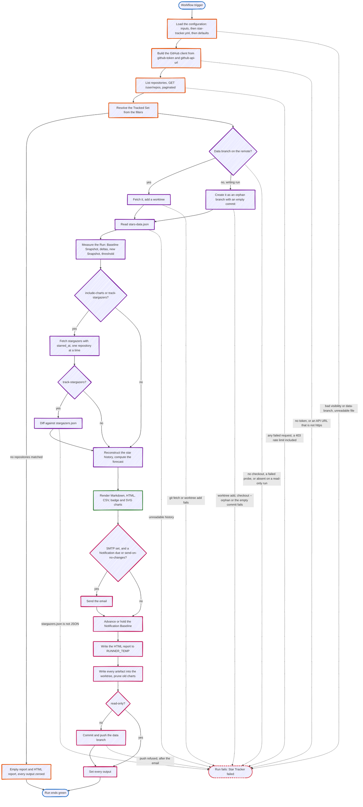
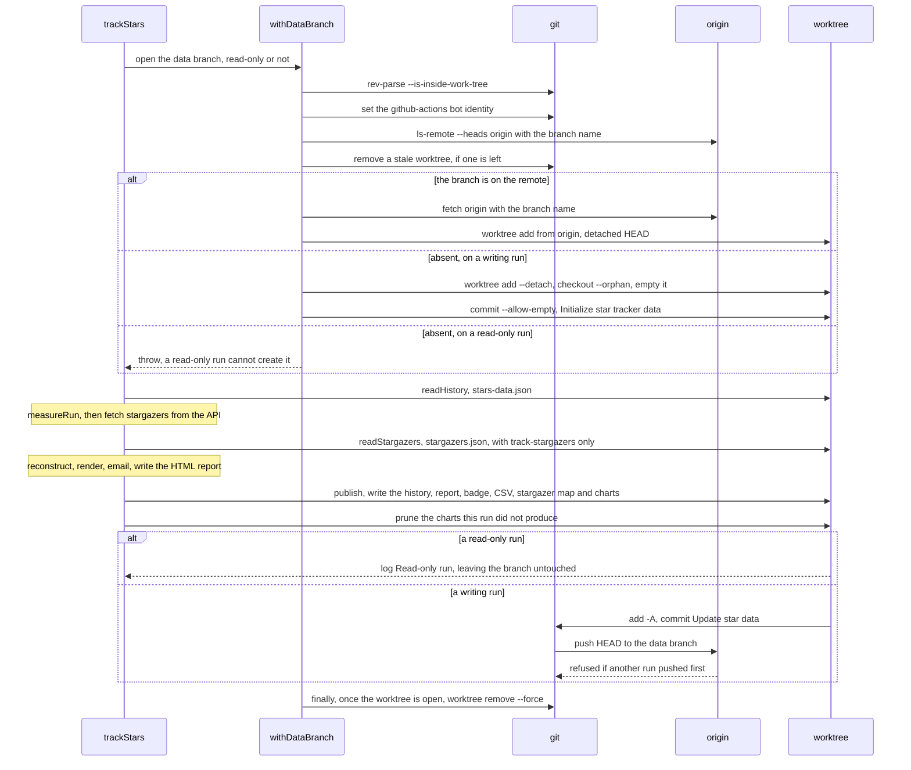

A deep dive into what one run of GitHub Star Tracker does, phase by phase: what each step reads, what it runs, what
you see, and what happens when the step cannot complete. For the layering the phases run inside, and what the
DDD<sub>(ish)</sub> in it does and does not mean, read **[Architecture](Architecture)**. How this repository's own
CI builds and releases the action is a different flow, in **[CI/CD](CI-CD)**.

---

## Execution Flow

A run is one step of your workflow, `fbuireu/github-star-tracker@v1`, executing `dist/index.js` on the runner. It
starts when that step does, whatever triggered the workflow (a `schedule`, a `workflow_dispatch`, anything else), and
it is over when the step is: nothing keeps running in the background.



The dashed edges are the ones that end a run red. Each phase below tags everything that can go wrong in it with one of
three outcomes:

| Outcome          | What happens                                                                                                                                                                                        | What you see                                                                                 |
| ---------------- | --------------------------------------------------------------------------------------------------------------------------------------------------------------------------------------------------- | -------------------------------------------------------------------------------------------- |
| **Fatal**        | The error reaches the single `try`/`catch` in `trackStars`, which calls `core.setFailed`. Nothing after that point runs: no later phase, and **no output is set**, because the outputs are set last | The step goes red with `Star Tracker failed: <message>`; the stack trace is in the debug log |
| **Degraded**     | The run carries on, and ends green, with less: one repository's stargazers, a chart's history, an email                                                                                             | A warning annotation naming what was lost                                                    |
| **Warning only** | A value is ignored or replaced by a fallback, and nothing else changes                                                                                                                              | A warning annotation, or, where the tables say so, nothing at all                            |

Once the data branch's worktree is open, it is removed in a `finally` whichever way the run ends, and that removal never
fails the run. A failure while the branch is still being opened skips that removal ([Cleanup](#cleanup)).

Two edges in the diagram are easy to miss, and they matter:
- **No repositories matched.** When every filter combined leaves nothing, the run warns
  `No repositories matched the configured filters`, renders an empty report, writes the HTML report, sets every output
  to its zeroed value and returns. It never opens the data branch, so nothing is committed and no email is attempted.
  The run still succeeds.
- **Read-only run.** With `read-only: true` everything happens except the push: the run reads the branch, computes,
  renders, writes every artefact into the worktree, sends the email and sets every output, then logs
  `Read-only run: leaving <branch> untouched` and discards the worktree unpushed. See
  [Read-only runs](#read-only-runs) below.

---

## A First Run

The first writing run on a fresh data branch takes the same path as every other, with nothing to compare against.
Everything it reports is therefore "new", and it is worth knowing what that looks like before it lands in an inbox:
- **The branch is created.** The probe finds nothing on the remote, so the run creates an orphan branch with an empty
  commit, and the run's own commit lands on top of it.
- **Every repository is a New Repository with a delta of `0`.** There is no Baseline Snapshot, so `stars-changed` is
  `true` while `new-stars` and `lost-stars` are `0`. The total delta is your whole total, which is what the email
  subject shows: `GitHub Star Tracker Report: 523 (+523)`.
- **The Notification is due as soon as your total reaches the threshold.** No Notification Baseline is stored yet, and
  an absent one counts as `0`, so the accumulated change is your whole total. With the default
  `notification-threshold: 0` it is due on this run; with SMTP configured, the first email lists every repository as
  new, and without SMTP `should-notify` is `true` and the baseline advances to your total all the same.
- **With `track-stargazers` on, every stargazer is new.** There is no `stargazers.json` to diff against, so
  `new-stargazers` counts every stargazer the run could read, and the report lists all of them. The same flood comes
  back on any later run that turns `track-stargazers` on for the first time, for a repository that joins the Tracked
  Set, and for one that is renamed ([Phase 5](#phase-5-stargazer-tracking)).
- **Charts and the forecast are there from the start.** Both are fitted to the history reconstructed from `starred_at`
  dates, not to the runs the tracker has made; velocity needs two stored Snapshots, so it appears from the second
  run at the earliest.

---

## Phase 1: Bootstrap & Configuration

### Entry Point

**File:** [`src/index.ts`](https://github.com/fbuireu/github-star-tracker/blob/main/src/index.ts)

A tiny bootstrap delegating to the application orchestrator:

```typescript
import { trackStars } from "@application/tracker";
trackStars();
```

### Orchestrator

**File:** [`src/application/tracker.ts`](https://github.com/fbuireu/github-star-tracker/blob/main/src/application/tracker.ts) > `trackStars()`

Coordinates every layer inside one `try`/`catch` that ends in `core.setFailed`. In order, it loads the configuration,
reads the required `github-token` input, resolves the API URL (the `github-api-url` input, else the runner's
`GITHUB_API_URL`), builds the Octokit client with `@octokit/plugin-retry` attached, and then runs the phases below.
There is no translation bootstrap: each renderer looks up the bundle for the configured `locale` when it needs a
string.

### Configuration Resolution

**File:** [`src/config/loader.ts`](https://github.com/fbuireu/github-star-tracker/blob/main/src/config/loader.ts) > `loadConfig()`

Configuration follows a **layered precedence model**:

```
Action Inputs > Config File (YAML) > Built-in Defaults
```

**Steps:**
1. File discovery: reads YAML from `config-path` input (default: `star-tracker.yml`). A missing file is fine and only
   logged
2. YAML parsing via `js-yaml`. An empty or whitespace-only file yields the defaults; a malformed one is logged as a
   warning and ignored as a whole; valid YAML that is not a mapping (a list, a bare string) is ignored without a word.
   None of these fails the run, but a file that exists and cannot be read does
3. Action input extraction via `@actions/core`
4. Type-safe conversion using parsers (`parseBool`, `parseList`, `parseHexColor`,
   `parseNotificationThreshold`, and the number parsers `parsePositiveNumber`,
   `parseNonNegativeNumber` and `parsePositiveDecimal`). Which number parser a key uses is deliberate,
   not interchangeable
5. Merge: inputs override file values; missing values fall through to defaults
6. Validation: an unknown `visibility` and an invalid `data-branch` throw; an unknown `locale`, `compare-against`,
   `notification-mode` or chart enum warns and falls back to its default

Config file keys may be written with either underscores or dashes (`include_charts` and `include-charts` both work):

```yaml
# star-tracker.yml
visibility: public
include_archived: false
include_forks: false
exclude_repos: [test-repo, /^demo-.*/]
only_repos: []
only_orgs: []
exclude_orgs: []
min_stars: 5
data_branch: star-tracker-data
read_only: false
max_history: 52
include_charts: true
locale: en
notification_threshold: 0
notification_mode: net
compare_against: last-run
track_stargazers: false
top_repos: 10
smart_sampling: false
smart_sampling_threshold: 1500
smart_sampling_pages: 30
chart_line_color: "#dfb317"
chart_line_width: 2.5
chart_max_points: 30
chart_y_axis_side: left
chart_smoothing: true
chart_curve: monotone
chart_show_points: true
chart_animation: true
chart_milestones: true
chart_begin_at_zero: false
chart_theme: auto
email_theme: auto # 'auto' inherits chart_theme
chart_custom_milestones: [] # e.g. [250, 750, 2500] to override the default milestones
chart_range: all
chart_trend_line: false
velocity_metrics: false
```

### What can go wrong in Phase 1

Everything here happens before a single request, so a fatal error costs nothing but the run.

| Situation                                                                              | Outcome                | What you see                                                          |
| -------------------------------------------------------------------------------------- | ---------------------- | --------------------------------------------------------------------- |
| `visibility` is not `public`, `private`, `all` or `owned`                              | **Fatal**              | `Invalid visibility "<value>". Must be one of: ...`                   |
| `data-branch` breaks git's branch-name rules, or is not a string in the file           | **Fatal**              | `Invalid data-branch ...`                                             |
| The file at `config-path` exists but cannot be read (a directory, no permission)       | **Fatal**              | Node's own read error                                                 |
| `github-token` is empty                                                                | **Fatal**              | `Input required and not supplied: github-token`                       |
| `github-api-url`, or `GITHUB_API_URL` when it is empty, is not an absolute `https` URL | **Fatal**              | `Invalid github-api-url "<value>" ...`                                |
| The config file is not valid YAML                                                      | Warning only           | `Failed to parse config file ...`, and the whole file is ignored      |
| The config file is valid YAML but not a mapping                                        | Warning only, silently | Nothing; the file is ignored                                          |
| Any other input, or an enum in the file, is invalid                                    | Warning only           | `Invalid <input> "<value>". ...`, then the next source or the default |
| A non-enum value in the file is invalid                                                | Warning only, silently | Nothing; the default applies                                          |
| `read-only` is on with a `notification-threshold` other than `0`                       | Warning only           | A warning that the threshold cannot work on a read-only run           |

[Configuration](Configuration#validation) has the full rules for each input.

---

## Phase 2: Data Fetching

### Repository Enumeration

**File:** [`src/infrastructure/github/client.ts`](https://github.com/fbuireu/github-star-tracker/blob/main/src/infrastructure/github/client.ts) > `fetchRepos()`

Queries `GET /user/repos` with pagination (`100` per page), sorted by full name. The `visibility` config maps to API
params:

| Config Value | API Params                          |
| ------------ | ----------------------------------- |
| `public`     | `visibility=public`                 |
| `private`    | `visibility=private`                |
| `all`        | `visibility=all`                    |
| `owned`      | `visibility=all, affiliation=owner` |

Every request goes through `@octokit/plugin-retry`, which retries a failed request three times, unless its status is
one it never retries: `400`, `401`, `403`, `404`, `410`, `422` and `451`. A `429`, a server error and a network failure
are retried; a `403` is not, which matters because GitHub answers an exhausted rate limit with `403` as often as
`429`.

### Data Transformation

**File:** [`src/infrastructure/github/filters.ts`](https://github.com/fbuireu/github-star-tracker/blob/main/src/infrastructure/github/filters.ts) > `mapRepos()`

Transforms GitHub API objects into the domain `RepoInfo` schema, flattening `owner.login`, normalizing `stargazers_count` to `stars`, etc. This happens **before** filtering, so every filter below is expressed over the domain shape rather than GitHub's.

### Repository Filtering

**File:** [`src/domain/tracked-set.ts`](https://github.com/fbuireu/github-star-tracker/blob/main/src/domain/tracked-set.ts) > `resolveTrackedSet()`

Client-side filtering pipeline, in this order:
1. **Org whitelist** (`onlyOrgs`) - restricts to owners whose name matches a listed name or `/regex/`
2. **Whitelist** (`onlyRepos`) - short-circuits everything below it, on the set step 1 already narrowed
3. **Archived** - removes archived repos unless `includeArchived` is `true`
4. **Forks** - removes forks unless `includeForks` is `true`
5. **Blacklist** (`excludeRepos`) - removes by exact name or regex (e.g. `/^test-.*/`)
6. **Org blacklist** (`excludeOrgs`) - removes repos whose owner matches a listed name or `/regex/`
7. **Star threshold** (`minStars`) - removes repos below minimum

The order matters in one direction: `only-repos` can never bring back a repository `only-orgs` excluded, because it runs on the already-narrowed set. Separately, `smart-sampling` (with `smart-sampling-threshold`/`smart-sampling-pages`) and the `chart-*` options also exist as inputs.

What survives is the **Tracked Set**. The rules are pure and return counts rather than logging them; `getRepos` writes those counts to the Action log.

### What can go wrong in Phase 2

Listing repositories is all or nothing: a run never measures part of an account.

| Situation                                                                               | Outcome                             | What you see                                                                                                                                                                                                                         |
| --------------------------------------------------------------------------------------- | ----------------------------------- | ------------------------------------------------------------------------------------------------------------------------------------------------------------------------------------------------------------------------------------ |
| The token is expired, revoked or mistyped (`401`)                                       | **Fatal**                           | `Failed to fetch repositories from GitHub API: HTTP 401 Bad credentials. Verify that your github-token has the correct permissions.`                                                                                                 |
| The token cannot list repositories, typically the workflow's own `GITHUB_TOKEN` (`403`) | **Fatal**                           | The same message with `HTTP 403 Resource not accessible by integration`                                                                                                                                                              |
| The rate limit is exhausted (`403`)                                                     | **Fatal**, never retried            | `HTTP 403 API rate limit exceeded ...`, followed by the same permissions hint, which is misleading here: the token is fine, the quota is not. See [Troubleshooting](Troubleshooting#api-rate-limit-exceeded-with-a-permissions-hint) |
| A `429`, a server error or a network failure                                            | Retried three times, then **Fatal** | The same message with the final status                                                                                                                                                                                               |
| A page, or a repository row, does not have the shape the action reads                   | **Fatal**                           | `GitHub returned a repository list this action cannot read: <path> ...`, without the permissions hint                                                                                                                                |
| A filter pattern is `/.../` but does not compile                                        | Warning only                        | `Ignoring invalid pattern "..."`, and the pattern matches nothing                                                                                                                                                                    |
| No repository survives the filters                                                      | Green, cut short                    | `No repositories matched the configured filters`, then the empty path above                                                                                                                                                          |

---

## Phase 3: The Data Branch

### Data Branch Initialization

**File:** [`src/infrastructure/git/worktree.ts`](https://github.com/fbuireu/github-star-tracker/blob/main/src/infrastructure/git/worktree.ts) > `initializeDataBranch()`

The run keeps its memory on a branch of your repository, and works on it in a **git worktree**: a second working
directory beside your checkout, so the action never runs `git checkout` on the branch your workflow is using.

**Directory derivation:** a dot followed by the branch name - e.g. `data-branch: my-stars` produces `.my-stars/`.

The whole life of that worktree, from the probe to the cleanup, in one run:



Step by step:
1. Confirm the process is inside a checked-out repository (`git rev-parse --is-inside-work-tree`)
2. Configure Git identity (`github-actions[bot]`)
3. Check if the data branch exists on the remote (`git ls-remote --heads`), reading **empty output** as "absent". A
   probe that _fails_ is never read that way: a network, DNS or auth failure would otherwise build an orphan and push
   it over the real branch
4. Remove a stale worktree if one is present
5. Refuse a read-only run when the branch does not exist
6. If the branch exists, which is every run but the first: `git fetch` + `git worktree add`, leaving a detached HEAD,
   which is why the push names `HEAD:<branch>`
7. Only if it does not: create an orphan branch with `git checkout --orphan` + an empty initial commit, so the data's
   history shares nothing with your code's

The remote commands carry `github-token`, but as a fallback: with `actions/checkout`'s default
`persist-credentials: true`, git sends the checkout's own credential instead, which is the workflow's `GITHUB_TOKEN`.
That is why the workflow needs `permissions: contents: write`.

### Cleanup

**File:** `src/infrastructure/git/worktree.ts` > `cleanup()`

Runs in a `finally` block around the run's body, removing the worktree with `--force` whether the body succeeds or
fails. `withDataBranch` opens the branch before that block, so a failure while opening it skips the cleanup. On the
orphan path that can leave a registered worktree behind, which the next run's stale-worktree removal clears on a runner
that keeps its workspace.

### What can go wrong in Phase 3

| Situation                                                                                                                                                                                                                                                                              | Outcome                 | What you see                                                                                                                |
| -------------------------------------------------------------------------------------------------------------------------------------------------------------------------------------------------------------------------------------------------------------------------------------- | ----------------------- | --------------------------------------------------------------------------------------------------------------------------- |
| No repository is checked out                                                                                                                                                                                                                                                           | **Fatal**               | `This action must run inside a checked-out repository. Add an "actions/checkout" step before this action in your workflow.` |
| git refuses the checkout (`detected dubious ownership`), or is not installed                                                                                                                                                                                                           | **Fatal**               | `Git command failed: "git rev-parse --is-inside-work-tree"` with git's own text                                             |
| The remote probe fails (network, DNS, credentials)                                                                                                                                                                                                                                     | **Fatal**               | `Git command failed: ...` with git's own text, never a silently created branch                                              |
| The branch is absent and the run is read-only                                                                                                                                                                                                                                          | **Fatal**               | `Branch "<name>" does not exist on the remote and this is a read-only run, so it cannot be created. ...`                    |
| The branch is on the remote, but `git fetch` or `git worktree add` fails: a network failure after the probe, or a `.<data-branch>` path git cannot reuse, such as a non-empty directory that is not a worktree, or a worktree git still has registered after its directory was deleted | **Fatal**               | `Git command failed: "git worktree add ..."` (or `fetch`) with git's own text, such as `already exists`                     |
| The branch is absent and the run writes                                                                                                                                                                                                                                                | Expected on a first run | `Branch "<name>" does not exist on remote, will create it`                                                                  |
| Creating the orphan fails at `worktree add --detach`, `checkout --orphan` or the empty commit                                                                                                                                                                                          | **Fatal**               | `Git command failed: ...` with git's own text                                                                               |
| A stale worktree, or the final one, cannot be removed                                                                                                                                                                                                                                  | Debug log only          | Nothing in the normal log; the run carries on, and a non-empty path left in place then fails `worktree add`, above          |

A read-only run may never bring the data branch into existence, so it stops rather than creating one and leaving it
unpushed. Point `data-branch` at the branch your tracking workflow maintains, or drop `read-only` for one run so it
can be created.

---

## Phase 4: State Comparison

### Reading the Stored History

**File:** [`src/infrastructure/persistence/storage.ts`](https://github.com/fbuireu/github-star-tracker/blob/main/src/infrastructure/persistence/storage.ts) > `readHistory()`

The first thing the run does with the worktree is read `stars-data.json`. Guards run before the stored file is trusted,
and each of them **fails the run** rather than continuing on a guess, because silently reading a populated data branch
as empty would append a snapshot over the top of a discarded record:

| Situation                                                                                  | What happens                                                                                                              |
| ------------------------------------------------------------------------------------------ | ------------------------------------------------------------------------------------------------------------------------- |
| The file is not valid JSON                                                                 | The run stops and names the parse error, asking you to fix or delete the file on the data branch                          |
| The file is valid JSON but not an object (`null`, an array, a number, a string)            | The run stops rather than reading it as an empty history                                                                  |
| The file declares a `version` higher than this action writes                               | The run stops and asks you to upgrade the action, or to point `data-branch` at a branch this version wrote                |
| The file is an object but its `snapshots` key is not an array                              | The run stops rather than reading it as an empty history                                                                  |
| A snapshot, one of its repository entries or `starsAtLastNotification` has the wrong shape | The run stops and names the path and what it found there, e.g. `snapshots[3].repos[0].stars (expected number, found "7")` |

`version` is stamped as the first key of the file by the writer and stripped again on read, so it never
reaches the report. An **absent** `version` means version 1 and is accepted, because every data branch that
predates the field has none. A missing file, or a `snapshots` key that is **absent**, is the one tolerated case,
because that is what the first run on a fresh branch looks like; a `snapshots` key that is present but holds something
other than an array stops the run like any other unreadable file.

The run does not call the steps below one by one. `measureRun()`
([`src/domain/measurement.ts`](https://github.com/fbuireu/github-star-tracker/blob/main/src/domain/measurement.ts)) composes baseline selection, diffing, snapshotting and the threshold check in
the one order that is correct, and returns the whole measurement in a single value. The reasoning is
[ADR 0013](https://github.com/fbuireu/github-star-tracker/blob/main/docs/adr/0013-a-run-is-measured-in-one-place.md).
The sections that follow describe what it does inside.

### Baseline Selection

**File:** [`src/domain/snapshot.ts`](https://github.com/fbuireu/github-star-tracker/blob/main/src/domain/snapshot.ts) > `getBaselineSnapshot()`

One snapshot of the Stored History is picked as the **baseline snapshot**. The `compare-against` input (config key
`compare_against`) decides which one:

| Value                | Baseline Snapshot                                                                                     |
| -------------------- | ----------------------------------------------------------------------------------------------------- |
| `last-run` (default) | The most recent stored snapshot                                                                       |
| `24h`                | The most recent snapshot at least 24 hours old, less a 6-hour tolerance: at least 18 hours            |
| `7d`                 | The most recent snapshot at least 7 days old, less the same tolerance: at least 6 days and 18 hours   |
| `30d`                | The most recent snapshot at least 30 days old, less the same tolerance: at least 29 days and 18 hours |

The tolerance exists so a scheduled run that starts a few minutes late does not fall just short of its own window
and silently compare against something older than you asked for.

The current star counts are then diffed against that snapshot, so the baseline defines the `new-stars`, `lost-stars` and `stars-changed` outputs, the total delta, and the "Compared to snapshot from ..." line in the report.

**Edge cases:**
- **History shorter than the window:** falls back to the oldest snapshot available. The reported period is then _shorter_ than the one requested, and the report's "Compared to" date shows exactly how far back it really goes
- **First run:** there is no history, therefore no baseline (see the `compareStars()` edge cases below)

The time windows make a genuine daily, weekly or monthly digest possible even when the tracker runs more frequently than that.

The baseline choice only changes what the current run is compared against; it never changes what gets stored. Every run still appends its own snapshot to the Stored History, and neither the charts, the forecast nor the velocity section is windowed by `compare-against`.

Those do not share one series, though, and the difference is worth knowing:

| Section  | Series it reads                                                                                               |
| -------- | ------------------------------------------------------------------------------------------------------------- |
| Charts   | the Reconstructed History, falling back to the Stored History when the reconstruction has fewer than 2 points |
| Forecast | the same aggregate Reconstructed History the charts use                                                       |
| Velocity | the **Stored History**, always                                                                                |

`renderRun` passes the two under separate names for that reason. Velocity is a rate over real elapsed time
between two runs, so it needs snapshots the tracker actually took; feeding it the reconstruction would make
it an average over a chart bucket whose width follows `chart-max-points`.

### Delta Computation

**File:** [`src/domain/comparison.ts`](https://github.com/fbuireu/github-star-tracker/blob/main/src/domain/comparison.ts) > `compareStars()`

Pure function computing the diff between current repos and the selected baseline snapshot:
1. Index the baseline state into a hash map
2. Compute per-repo deltas (current - baseline)
3. Detect new repos (`isNew`) and removed repos (`isRemoved`)
4. Aggregate summary: `totalStars`, `totalDelta`, `newStars`, `lostStars`, `changed`

**Edge cases:**
- First run: there is no baseline, so every repo is `isNew: true` with `previous: null` and `delta: 0`. New
  repos never inflate `newStars`, but they do make `summary.changed` true
- Repo renamed or transferred: appears as removed + new, and its whole count is reported as lost
- Repo deleted: marked `isRemoved: true`, `current: 0`

### Snapshot Management

**File:** `src/domain/snapshot.ts`
- The `compare-against: last-run` baseline is the most recent snapshot that parses, resolved inside
  `getBaselineSnapshot` (the walk-back is module-private)
- `addSnapshot({ history, snapshot, maxHistory })` returns a new `History` with the snapshot appended and old entries pruned beyond `maxHistory`

Both are pure functions returning new objects (no mutation). `addSnapshot()` runs on every execution regardless of `compare-against`, so the Stored History is always complete.

### What can go wrong in Phase 4

| Situation                                               | Outcome                | What you see                                                                                                            |
| ------------------------------------------------------- | ---------------------- | ----------------------------------------------------------------------------------------------------------------------- |
| `stars-data.json` fails any guard in the table above    | **Fatal**              | `stars-data.json on the data branch ...`, naming what is wrong and how to fix it                                        |
| More snapshots are stored than `max-history` now allows | Warning only           | `max-history is N but M snapshots are stored, so this run drops the oldest K. ...`; once this run pushes, they are gone |
| A snapshot's `timestamp` does not parse                 | Warning only, silently | It is skipped when picking the baseline, and the next snapshot that parses is used                                      |

---

## Phase 5: Stargazer Tracking

**Files:** [`src/infrastructure/github/stargazers.ts`](https://github.com/fbuireu/github-star-tracker/blob/main/src/infrastructure/github/stargazers.ts), [`src/domain/stargazers.ts`](https://github.com/fbuireu/github-star-tracker/blob/main/src/domain/stargazers.ts)

Stargazers are fetched whenever charts are enabled (`include-charts: true`, the default) **OR** `track-stargazers: true`, because the Reconstructed History behind the charts needs each star's `starred_at` date. With both off, this phase is skipped entirely.
1. **Fetch:** queries `GET /repos/{owner}/{repo}/stargazers` with the `star+json` media type to get `starred_at`
   timestamps. Paginated at 100 per page, one repository after another, never in parallel, because parallel requests
   trip GitHub's secondary rate limit. A full fetch stops at the first page that is not full, or at page 400, the
   deepest GitHub serves; a repository over `smart-sampling-threshold` with `smart-sampling` on reads only an evenly
   spread set of pages instead.
2. **Diff (only when `track-stargazers: true`):** compares current stargazer logins against the previously stored `stargazers.json` map to identify new stargazers.
3. **Persist (only when `track-stargazers: true`):** the updated map is handed to Phase 9, which writes `stargazers.json` (repo > login array) to the data branch with everything else.

New stargazers appear in reports with avatar, profile link, and starred date.

Some kinds of repository are skipped by the diff, and only one of them says so. A **sampled** repository is
excluded deliberately (absence from a sample is not evidence) and is named in a note in the report. A
repository whose list came back `incomplete` is skipped **silently**. Either way its stars still count, so
`new-stargazers` can read `0` on a run where the totals clearly moved, and either way its stored logins are kept
rather than overwritten.

### When every stargazer looks new

The diff compares against the logins stored under the repository's **full name**. A repository with no entry there
has nothing to be compared with, so every one of its stargazers is reported as new:
- **The first run with `track-stargazers` on**, whether the data branch is fresh or has run for months without it.
  Every stargazer of every repository is new at once.
- **A repository that joins the Tracked Set**: created, unarchived, or let in by an edited filter.
- **A repository renamed or transferred.** Its new full name has no entry. The old entry stays behind, since entries
  are never removed, and its per-repo chart moves to a new file name too, so an image embedded from the old URL stops
  updating.
- **A `stargazers.json` the reader had to repair**, below.

Each of these settles on the following run, once the entry exists.

### What can go wrong in Phase 5

One repository's stargazers never fail the run: a failure costs that repository's history and diff, not the run.

| Situation                                                                                                                                                               | Outcome                | What you see                                                                                                                                                            |
| ----------------------------------------------------------------------------------------------------------------------------------------------------------------------- | ---------------------- | ----------------------------------------------------------------------------------------------------------------------------------------------------------------------- |
| The first page fails: `403` or `404` for a token whose user is not an admin or collaborator, a `403` rate limit, or a `429` or server error that survived three retries | Degraded               | `Failed to fetch stargazers for <repo>: HTTP <status> ...`; its chart falls back to the Stored History and the diff skips it                                            |
| The list comes back empty for a repository that has stars                                                                                                               | Degraded               | `Stargazers for <repo> came back empty even though it has N stars ...`, with the same consequences                                                                      |
| A later page fails                                                                                                                                                      | Degraded               | `Stopped fetching stargazers for <repo> at page N ...; keeping the M fetched so far`; its chart is drawn from those and ramped to the true total, and the diff skips it |
| A full fetch reaches page 400                                                                                                                                           | Degraded               | `... hit GitHub's pagination ceiling ...`; the oldest 40,000 are charted and ramped, and the diff skips it                                                              |
| Some pages of a sampled repository fail                                                                                                                                 | Degraded               | `Skipped N/M sampled stargazer pages for <repo> ...`; the rest are charted                                                                                              |
| No stargazer carries a usable `starred_at`                                                                                                                              | Degraded               | `Stargazers for <repo> came back without usable starred_at dates ...`                                                                                                   |
| A page has a shape the action cannot read (a `null` user)                                                                                                               | Degraded               | The same warning as a failed request, naming the path                                                                                                                   |
| `stargazers.json` is not valid JSON                                                                                                                                     | **Fatal**              | `stargazers.json on the data branch is not valid JSON (...). Fix or delete the file on that branch and re-run.`                                                         |
| `stargazers.json` parses but is not an object, or an entry is not a list of logins                                                                                      | Warning only, silently | It is repaired: read as empty, or the entry dropped, and those repositories' stargazers are all reported as new                                                         |

---

## Phase 5b: Reconstructed History

**File:** [`src/domain/star-history.ts`](https://github.com/fbuireu/github-star-tracker/blob/main/src/domain/star-history.ts) > `buildStarHistory()`

When charts are enabled, `buildStarHistory()` turns the fetched stargazers' `starred_at` dates into a **Reconstructed History**: a cumulative `History` over real time, used by the charts and by the forecast. Each star is placed on the date it was actually given and the cumulative total is rebuilt from the repo's first star up to now, so a multi-point curve is available on the **first run**. It is rebuilt from scratch every run and never stored.

GitHub caps stargazer listing at roughly **40,000 per repo**, oldest first. Above that cap it is therefore the **recent** stars that are unreachable, not the early ones.

`scaleCappedToTrueTotal()` draws the reachable stretch accurately and bridges the missing tail with a straight ramp up to the true current total, so the final point always equals the true count. The reasoning is [ADR 0007](https://github.com/fbuireu/github-star-tracker/blob/main/docs/adr/0007-bridge-unreachable-history-with-a-ramp.md); the user-facing consequences are in [Known Limitations](Known-Limitations#stargazer-listing-cap-40000).

Pair high-star repos with `smart-sampling` to keep within rate limits. How a chart goes from these histories to an SVG
file and an email image is drawn in [Star Trend Charts](Star-Trend-Charts#how-a-chart-is-built).

---

## Phase 6: Growth Forecast

**File:** [`src/domain/forecast.ts`](https://github.com/fbuireu/github-star-tracker/blob/main/src/domain/forecast.ts) > `computeForecast()`

Requires at least **3 points** (`MIN_SNAPSHOTS_FOR_FORECAST`). Projects **4 calendar weeks ahead** (`FORECAST_WEEKS`): "Week 1" means 7 real days after the latest point, "Week 4" means 28 days after it. When charts are enabled, the History passed to forecast generation is the aggregate **Reconstructed History**, not the Stored History, so the 3-point minimum refers to points in that reconstruction.

Both methods are **time-aware**: they use each point's real timestamp to derive a stars-per-day rate, so predictions do not depend on how far apart the points happen to be. That matters because the two possible series are spaced very differently: a Reconstructed History spreads its points across the repository's entire lifetime, while a Stored History follows your workflow schedule.

The methods are computed in parallel:

| Method                      | Description                                                                       | Strength                                      |
| --------------------------- | --------------------------------------------------------------------------------- | --------------------------------------------- |
| **Linear Regression**       | Least-squares fit of stars over elapsed days, across the whole series             | Resilient to noise, captures long-term trends |
| **Weighted Moving Average** | Per-day growth rates between consecutive points, recent intervals weighted higher | Responsive to acceleration/deceleration       |

Both methods anchor their forecast on the latest observed total (they answer "starting from today's count, where does this trend land in N weeks?") and clamp predictions to `Math.max(0, Math.round(value))`.

Forecasts are computed for:
- **Aggregate** (total stars across all repos)
- **Per top repo** (top N by star count, configurable via `top-repos`), fitted to that repo's own reconstructed history when it has at least 3 points, and otherwise to the points of the aggregate series that include the repo. A repo that fewer than 3 points include gets no forecast table of its own, rather than one fitted to zeros from before it was tracked.

---

## Phase 6b: Growth Velocity

**File:** [`src/domain/velocity.ts`](https://github.com/fbuireu/github-star-tracker/blob/main/src/domain/velocity.ts) > `computeVelocity()`

Opt-in via `velocity-metrics` (config key `velocity_metrics`), off by default. Where the forecast looks
forward, velocity describes how fast the tracked set is moving **right now**, and it is the one section
computed from the **Stored History** rather than the reconstruction.

It reads the newest snapshot and the newest earlier snapshot at least **0.25 days** back
(`MIN_RATE_INTERVAL_DAYS`), skipping anything closer so a manual re-run minutes after a scheduled one cannot
inflate the rate. It is a recent-period rate, never an all-time average.

| Figure                 | How it is derived                                                                                                                                                            |
| ---------------------- | ---------------------------------------------------------------------------------------------------------------------------------------------------------------------------- |
| Stars per day          | stars gained over that pair, divided by the elapsed days, rounded to 2 decimals                                                                                              |
| Growth percent         | the same gain as a percentage of the earlier total, rounded to 1 decimal. `null` when that earlier total is `0`, since there is nothing to be a percentage of                |
| Days to next milestone | `ceil((next milestone - current total) / stars per day)`, using the already-rounded rate. `null` when the rate is not positive, and `null` at or above the largest milestone |

The section returns nothing at all when there are fewer than two snapshots, when the newest timestamp does
not parse, or when no pair is far enough apart. **It is not windowed like the forecast:** velocity needs a
true duration between two real observations, which is why it never reads the Reconstructed History
([ADR 0017](https://github.com/fbuireu/github-star-tracker/blob/main/docs/adr/0017-velocity-and-forecast-read-unparseable-timestamps-differently.md)).

Where it appears in the report depends on the forecast: with a forecast it nests as a subsection under the
forecast heading, without one it is a top-level section of its own.

---

## Phase 7: Report Generation

**File:** [`src/presentation/run.ts`](https://github.com/fbuireu/github-star-tracker/blob/main/src/presentation/run.ts) > `renderRun()`

The presentation layer's single entry point. It builds one `ReportModel` and hands the same one to both report dialects, then returns the Markdown, HTML, CSV, badge and chart files together. One model means both reports carry the same date and the same Top Repositories. Rendering is pure: it reads no file and makes no request, so nothing in this phase fails a run.

### Shared Data Preparation

**File:** [`src/presentation/report-model.ts`](https://github.com/fbuireu/github-star-tracker/blob/main/src/presentation/report-model.ts) > `buildReportModel()`, over [`shared.ts`](https://github.com/fbuireu/github-star-tracker/blob/main/src/presentation/shared.ts) > `prepareReportData()`

Decides which sections a report has and what is in them: filters active/new/removed repos, sorts by stars, formats dates, and resolves the chart history, Velocity figures and Stargazer outcome once.

### Markdown Report

**File:** [`src/presentation/markdown.ts`](https://github.com/fbuireu/github-star-tracker/blob/main/src/presentation/markdown.ts) > `generateMarkdownReport()`

Produces GitHub Flavored Markdown with:
1. Header (total stars, delta, date)
2. Comparison note to the baseline snapshot ("Compared to snapshot from ...", dated per `compare-against`)
3. Chart sections (SVG references: `./charts/star-history.svg`, etc.)
4. Repository table (sorted, linked, with `NEW` badges)
5. New / removed repository sections
6. Summary metrics
7. Stargazer section (collapsible `<details>` per repo)
8. Forecast section (growth velocity first, then aggregate table and collapsible per-repo tables)
9. Footer

**Output:** committed as `README.md` on the data branch.

### HTML Report

**File:** [`src/presentation/html.ts`](https://github.com/fbuireu/github-star-tracker/blob/main/src/presentation/html.ts) > `generateHtmlReport()`

Self-contained HTML with inline CSS for email compatibility. Uses QuickChart.io URLs for chart images (since SVGs with CSS animations aren't supported in email clients). No `<details>` elements (not supported in email).

### CSV Report

**File:** [`src/presentation/csv.ts`](https://github.com/fbuireu/github-star-tracker/blob/main/src/presentation/csv.ts) > `generateCsvReport()`

Machine-readable CSV with one row per tracked repository. Columns: `repository`, `owner`, `name`, `stars`, `previous`, `delta`, `status`. Fields containing a comma, a double quote or a line break are quoted per RFC 4180, and a field starting with `=`, `+`, `-` or `@` is prefixed with `'` and quoted, so a spreadsheet does not run it as a formula.
- `status` is `active`, `new` (absent from the Baseline Snapshot), or `removed` (in it, absent now)
- `previous` is empty and `delta` is `0` for new repos; a removed repo has `stars` of `0` and a `delta` of minus its `previous`

Available as both a file on the data branch (`stars-data.csv`) and an action output (`report-csv`).

### SVG Charts

**File:** [`src/presentation/svg-chart.ts`](https://github.com/fbuireu/github-star-tracker/blob/main/src/presentation/svg-chart.ts)

Generates self-contained animated SVG charts committed to `charts/` on the data branch:

| Chart             | File                                 | Description                                   |
| ----------------- | ------------------------------------ | --------------------------------------------- |
| Star History      | `charts/star-history.svg`            | Total stars over time with milestone markers  |
| Per-Repo          | `charts/{owner}-{repo}.svg`          | Individual repo history                       |
| Comparison        | `charts/comparison.svg`              | Top N repos overlaid                          |
| Forecast          | `charts/forecast.svg`                | Historical + projected trends (dashed lines)  |
| Per-Repo Forecast | `charts/forecast-{owner}-{repo}.svg` | One repo's history + its own projected trends |

Features: smooth curves (`monotone` by default, several shapes available), CSS draw-line animation, fade-in point markers, nice Y-axis steps, locale-aware date labels, legend (for multi-series).

When charts are enabled, the History passed to chart generation is the **Reconstructed History**, not the Stored History. At least **2 points** (`MIN_SNAPSHOTS_FOR_CHART`) are needed; below that the Stored History is used as the fallback, so a chart is still drawn, just over the tracker's own runs rather than the repository's life.

### QuickChart URLs (HTML reports)

**File:** [`src/presentation/chart.ts`](https://github.com/fbuireu/github-star-tracker/blob/main/src/presentation/chart.ts)

Generates Chart.js configuration encoded as QuickChart.io URLs for embedding in HTML emails. Same chart types but
rendered as static PNG images. The URL carries the chart's whole configuration, repository names in its title and
legend included, and quickchart.io receives it when the email's images load.

### SVG Badge

**File:** [`src/presentation/badge.ts`](https://github.com/fbuireu/github-star-tracker/blob/main/src/presentation/badge.ts) > `generateBadge()`

Creates a Shields.io-style SVG badge with the localized "Total Stars" label and a compact-formatted count (e.g. `1.5K`). Committed as [`stars-badge.svg`](https://github.com/fbuireu/github-star-tracker/blob/main/docs/examples/stars-badge.svg).

---

## Phase 8: Notification

The email goes out **before** anything is saved, deliberately, so the Notification Baseline that gets saved can
reflect whether it was delivered: saving first would reset the accumulated change before anyone knew whether the email
left. The cost is a possible duplicate rather than a lost Notification: if saving then fails, the next run measures
from the old baseline and notifies again
([ADR 0011](https://github.com/fbuireu/github-star-tracker/blob/main/docs/adr/0011-the-notification-baseline-advances-only-on-delivery.md)).

### Notification Threshold

**File:** [`src/domain/notification.ts`](https://github.com/fbuireu/github-star-tracker/blob/main/src/domain/notification.ts) > `shouldNotify()`

Controls when notifications fire. A notification always requires that something actually changed:

| Threshold Value | Behavior                                                       |
| --------------- | -------------------------------------------------------------- |
| `0` (default)   | Notify on every run with changes                               |
| `N` (number)    | Notify when accumulated change since last notification >= N    |
| `auto`          | Adaptive: 1 (<= 50 stars), 5 (<= 200), 10 (<= 500), 20 (> 500) |

`starsAtLastNotification` is persisted in `stars-data.json`, and the accumulated change is measured against
that stored value rather than against the previous run: the counter does **not** reset on runs that do not
notify, it keeps accumulating until it trips.

Whether a run advances it depends on the decision _and_ on what the transport did. The outcomes:

| The run decided to notify, and the send was                             | Baseline                                                                                     |
| ----------------------------------------------------------------------- | -------------------------------------------------------------------------------------------- |
| Successful                                                              | advances to the current total                                                                |
| Never attempted, because no SMTP is configured at all                   | advances to the current total, because the `should-notify` output _is_ the notification here |
| Attempted and failed, including an `smtp-host` with an empty `email-to` | held back, so the accumulated change is not lost                                             |

Only an attempted-and-failed send holds it. A run that decides **not** to notify never touches it, whatever the
transport, and a run that saves nothing (a read-only run, or one whose push is refused) leaves the stored value where
it was whatever it decided. [Email Notifications](Email-Notifications#how-the-notification-baseline-moves) draws the
whole cycle.

The `notification-mode` input (config key `notification_mode`) decides how that accumulated change is measured:

| Mode            | Behavior                                                                                                                                                        |
| --------------- | --------------------------------------------------------------------------------------------------------------------------------------------------------------- |
| `net` (default) | The absolute change in total stars since the last notification. Gains and losses across repos cancel out, and a large **drop** also reaches the threshold       |
| `gains`         | Only upward movement counts. The threshold is reached when the total has risen by at least N since the last notification; a drop never triggers a notification. |

`notification-threshold: '0'` still means "notify on every run with changes", regardless of mode.

On a fresh data branch there is no stored baseline, so the first run fires as soon as your total reaches the threshold
and then settles; raising the threshold on a branch that has been notifying fires nothing immediately.
[`notification-threshold`](Configuration#notification-threshold) explains both cases.

### Email

**File:** [`src/infrastructure/notification/email.ts`](https://github.com/fbuireu/github-star-tracker/blob/main/src/infrastructure/notification/email.ts)
- `getEmailConfig()` reads SMTP inputs; returns `null` if `smtp-host` is not set
- The email is attempted when SMTP is configured and the Notification is due, or `send-on-no-changes` is on
- `sendEmail()` uses `nodemailer` with auto-detected `secure` mode (port 465 = SSL, else STARTTLS)
- An `smtp-host` set with an empty `email-to` warns and skips the send, and counts as a failed delivery
- Email failures are non-fatal (logged as warning, action continues)

### What can go wrong in Phase 8

Email never fails a run: every outcome below ends green, and only decides whether the baseline moves.

| Situation                                    | Outcome      | What you see                                                                                                              |
| -------------------------------------------- | ------------ | ------------------------------------------------------------------------------------------------------------------------- |
| The SMTP send throws (connection, auth, TLS) | Degraded     | `Failed to send email: <reason>`; `notification-sent` is `false` and the baseline is held                                 |
| `smtp-host` is set but `email-to` is empty   | Degraded     | `SMTP configured but no email-to address provided, skipping email`; counted as a failed delivery, so the baseline is held |
| The server refuses some recipients           | Warning only | `Email rejected for: <addresses>`; still counted as sent, so the baseline advances                                        |
| `smtp-port` is not a port                    | Warning only | `Invalid smtp-port "<value>". Falling back to 587.`, which also switches the transport to STARTTLS                        |
| SMTP is configured but nothing is due        | Info         | `Notification threshold not reached, skipping email` or `No stars changed since the Baseline Snapshot, skipping email`    |

---

## Phase 9: Persistence & Commit

**File:** [`src/infrastructure/persistence/data-branch.ts`](https://github.com/fbuireu/github-star-tracker/blob/main/src/infrastructure/persistence/data-branch.ts) > `publish()`, over [`storage.ts`](https://github.com/fbuireu/github-star-tracker/blob/main/src/infrastructure/persistence/storage.ts)

First the HTML report is written **off** the data branch, to `RUNNER_TEMP` (or the working directory when that is
unset), so it outlives the worktree, exists on read-only runs and never reaches a commit. It is written before
anything is published on purpose: a write that failed after the push would end red a run that had already recorded
everything.

Then `publish()` writes the data branch, in this order:

| Function                     | File Written                                       |
| ---------------------------- | -------------------------------------------------- |
| `writeHistory()`             | `stars-data.json`                                  |
| `writeArtefact()` (`REPORT`) | `README.md`                                        |
| `writeArtefact()` (`BADGE`)  | `stars-badge.svg`                                  |
| `writeArtefact()` (`CSV`)    | `stars-data.csv`                                   |
| `writeStargazers()`          | `stargazers.json`, only with `track-stargazers` on |
| `writeChart()`               | `charts/{filename}`, one call per chart            |

All of those writes happen in one `publish()` call, followed by chart pruning and then the commit. Anything written
after the commit would not be staged.

### Chart Pruning

**File:** `src/infrastructure/persistence/storage.ts` > `pruneCharts()`

After the charts are written, every `charts/*.svg` this run did **not** produce is deleted and the count is
logged. That is what stops a repository dropping out of `top-repos` from stranding its chart on the branch
forever. Only `.svg` files inside `charts/` are considered; nothing outside that directory is ever removed.

### Git Commit

**File:** `src/infrastructure/persistence/storage.ts` > `commitAndPush()`

On a read-only run this step is skipped entirely: everything above has already been written into the
worktree, the run logs `Read-only run: leaving <branch> untouched`, and the worktree is discarded unpushed.

Otherwise:
1. `git add -A`
2. `git diff --cached --quiet` (skip if no changes)
3. `git commit -m "Update star data: 1523 total (+15)"`
4. `git push origin HEAD:{dataBranch}`

Step 2 guards against an empty commit, but on a writing run it never finds one: every run appends a Snapshot stamped
with its own time, so there is always something to commit, even when no star moved. The data branch gains one commit
per writing run.

A rejected push is the one git failure that gets its own message. The worktree is pinned to
`origin/<data-branch>` when the run starts and never re-fetched, so two overlapping _writing_ runs branch
from the same commit and the second push is refused as non-fast-forward. The run then fails with an
explanation naming `concurrency` and `read-only` as the two fixes. Every other push failure keeps git's own wording,
because that detail is the useful part.

### Read-only runs

`read-only: true` makes a run a pure reader of the data branch. It still fetches, compares, renders every
artefact into the worktree, sets every output and sends the email; it just never commits or pushes,
and the worktree is thrown away at the end. That is what lets another workflow (a weekly digest, say) share
a data branch with the workflow that maintains it without the two racing to write.

Consequences follow from nothing being written:
- The branch must already exist. A read-only run refuses to create it (see Phase 3).
- `starsAtLastNotification` never advances, so a `notification-threshold` other than `0` cannot work on a
  read-only run: it would either fire every time or never. `loadConfig` warns when both are set.

### What can go wrong in Phase 9

Everything here happens **after the email went out**, and before any output is set. A fatal error in this phase
therefore ends a run red that has already notified you, sets no output, and records nothing.

| Situation                                                                               | Outcome   | What you see                                                                                                                                                |
| --------------------------------------------------------------------------------------- | --------- | ----------------------------------------------------------------------------------------------------------------------------------------------------------- |
| Another writing run pushed first                                                        | **Fatal** | `Another run pushed to "<branch>" while this one was working, so this run's snapshot was not recorded; its report and any email have already gone out. ...` |
| The push is refused for any other reason: no `contents: write`, a protected data branch | **Fatal** | `Git command failed: "git ... push ..."` with git's own text                                                                                                |
| The HTML report cannot be written                                                       | **Fatal** | Node's own write error, before anything is pushed                                                                                                           |

Re-running records the snapshot. Because the Notification Baseline the failed run would have advanced was not pushed
either, the next run measures from the old one and may send an email much like the last.

---

## Phase 10: Outputs

**File:** `src/application/tracker.ts` > `setOutputs()`

Set once, as the run's last step, whether the run is read-only or not. The empty path sets them too, to zeroed values;
a run that fails anywhere sets none.

| Output              | Description                                                                                                                                                                                                             |
| ------------------- | ----------------------------------------------------------------------------------------------------------------------------------------------------------------------------------------------------------------------- |
| `report`            | Full Markdown report                                                                                                                                                                                                    |
| `report-html`       | HTML report (for email)                                                                                                                                                                                                 |
| `report-html-path`  | Filesystem path the HTML report was written to, outside the data branch                                                                                                                                                 |
| `report-csv`        | CSV report (for data pipelines)                                                                                                                                                                                         |
| `total-stars`       | Total star count                                                                                                                                                                                                        |
| `stars-changed`     | Per-run: whether any counts changed against the baseline (`true`/`false`)                                                                                                                                               |
| `new-stars`         | Per-run: stars gained since the comparison baseline                                                                                                                                                                     |
| `lost-stars`        | Per-run: stars lost since the comparison baseline                                                                                                                                                                       |
| `should-notify`     | Cumulative: whether the notification threshold was reached since the last notification fired                                                                                                                            |
| `notification-sent` | Whether an email actually left the runner. Distinct from `should-notify`: a courtesy send under `send-on-no-changes` sets this without the threshold being reached, and a configured send that failed leaves it `false` |
| `new-stargazers`    | New stargazers detected by diffing against the stored `stargazers.json`, which every writing run rewrites - not affected by `compare-against` (0 if tracking disabled)                                                  |

Per-run vs cumulative. `new-stars`, `lost-stars` and `stars-changed` are per-run figures measured against the baseline selected in Phase 4. They are not cumulative across runs and carry no memory of whether an email was ever sent - with a daily cron and `compare-against: last-run` they mean "gains in the last 24 hours". `should-notify` is the cumulative one: it is driven by `notification-threshold` plus `notification-mode` against `starsAtLastNotification`, and its counter only resets when the threshold trips ([the full rule](Configuration#notification-threshold)).

Because of that, "email me every 500 stars" is expressed as `notification-threshold: '500'` plus `notification-mode: 'gains'`, gated on `if: steps.tracker.outputs.should-notify == 'true'`. It is **not** `if: steps.tracker.outputs.new-stars >= 500`, which would require 500 stars inside a single run and would therefore almost never fire on a daily schedule.

---

## Module Dependency Map

```
src/
├── index.ts                          # Entry point
├── application/
│   └── tracker.ts                    # Orchestrator
├── config/
│   ├── types.ts                      # Config, Visibility, ChartCurve/Theme/Range types
│   ├── defaults.ts                   # DEFAULTS
│   ├── parsers.ts                    # bool, list, hex-colour and the three number parsers
│   └── loader.ts                     # loadConfig(), loadConfigFile(), enumField()
├── domain/
│   ├── types.ts                      # RepoInfo, Snapshot, History, Summary, CompareAgainst, NotificationMode
│   ├── constants.ts                  # MS_PER_DAY, STAR_MILESTONES, NOTIFICATION_THRESHOLDS
│   ├── time.ts                       # toEpochMs() - the layer's only timestamp entry point
│   ├── measurement.ts                # measureRun() - the layer's front door
│   ├── comparison.ts                 # compareStars(), createSnapshot(), rankByStars(), topRepositories()
│   ├── snapshot.ts                   # getBaselineSnapshot(), addSnapshot(), repoStarSeries()
│   ├── formatting.ts                 # formatCount(), deltaIndicator(), trendIcon(), formatDate(), buildAxisLabels()
│   ├── notification.ts               # shouldNotify(), notificationIsDue(), settleNotification()
│   ├── tracked-set.ts                # resolveTrackedSet() - which repositories a Run measures
│   ├── sampling.ts                   # shouldSample(), sampledPages(), coveredStars()
│   ├── growth.ts                     # calendarDays(), latestRateInterval(), weightedDailyRate(), fitTrend()
│   ├── forecast.ts                   # computeForecast()
│   ├── velocity.ts                   # computeVelocity()
│   ├── star-history.ts               # buildStarHistory() - the Reconstructed History
│   └── stargazers.ts                 # diffStargazers(), buildStargazerMap()
├── i18n/
│   ├── index.ts                      # LOCALE_MAP, LOCALES, getTranslations(), interpolate()
│   ├── types.ts                      # Translations interface
│   └── {en,es,ca,it}.json            # Translation files
├── infrastructure/
│   ├── git/
│   │   ├── commands.ts               # execute() - execFileSync('git', args), no shell
│   │   └── worktree.ts               # initializeDataBranch(), cleanup()
│   ├── github/
│   │   ├── types.ts                  # Octokit type, GitHubRepo and stargazer-row schemas
│   │   ├── client.ts                 # fetchRepos()
│   │   ├── filters.ts                # mapRepos(), getRepos()
│   │   └── stargazers.ts             # fetchAllStargazers()
│   ├── notification/
│   │   └── email.ts                  # getEmailConfig(), sendEmail()
│   └── persistence/
│       ├── data-branch.ts            # withDataBranch() - the folder's only external surface
│       └── storage.ts                # readHistory(), writeArtefact(), writeChart(), pruneCharts(), commitAndPush()
└── presentation/
    ├── constants.ts                  # COLORS, CHART, BADGE, SVG_CHART, CHART_FILES, SECTION_ICON
    ├── run.ts                        # renderRun() - the layer's single entry point
    ├── shared.ts                     # prepareReportData(), resolvePalette(), emailChartStyle()
    ├── report-model.ts               # buildReportModel() - which sections a report has
    ├── escaping.ts                   # escapeFor(dialect) - every escaper in the layer
    ├── markdown.ts                   # generateMarkdownReport()
    ├── html.ts                       # generateHtmlReport()
    ├── csv.ts                        # generateCsvReport()
    ├── chart-spec.ts                 # ChartRequest, buildChartSpec() - what a chart contains
    ├── chart.ts                      # chartImageUrl() (QuickChart for HTML emails)
    ├── svg-chart.ts                  # renderSvgChart() (animated SVGs for data branch)
    ├── charts.ts                     # resolveChartHistories(), buildChartFiles() - which charts a run produces
    └── badge.ts                      # generateBadge()
```

---

## Error Handling

- **One `try`/`catch`:** every fatal error in the phases above ends in `core.setFailed('Star Tracker failed: <message>')`,
  with the stack in the debug log. Each phase's table says which situations those are
- **Degraded, never fatal:** one repository's failed stargazer fetch, and a failed email
- **Outputs come last:** a run that fails sets none, even one that fails after its email went out
- **Worktree cleanup:** runs in `finally` once the worktree is open, and its own failure only reaches the debug log
